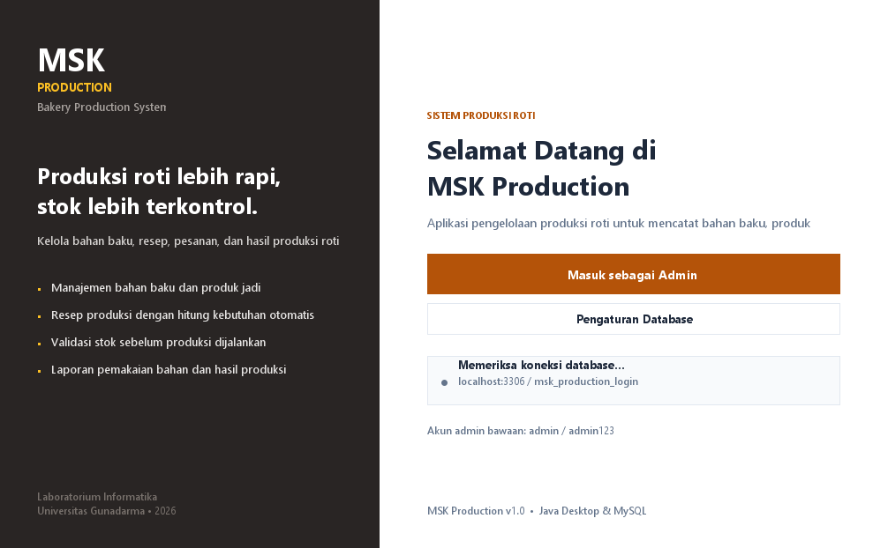
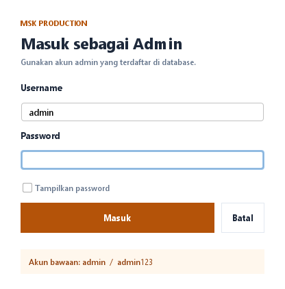
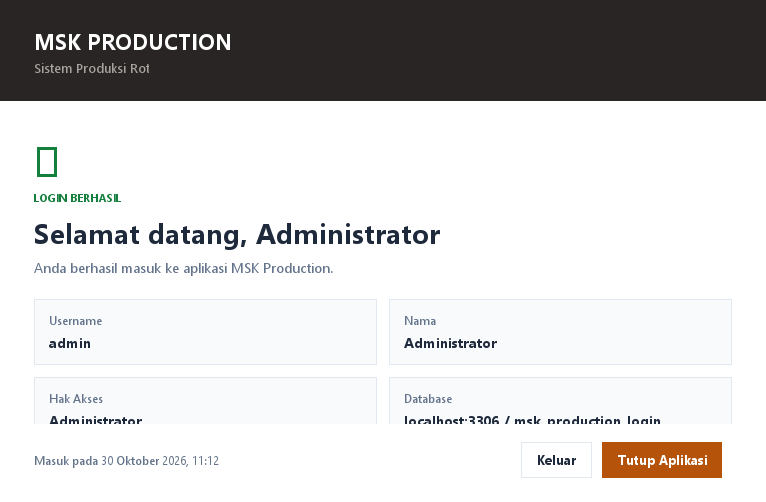

# MSK Production - Tahap Login

Versi ringkas aplikasi **MSK Production** yang berfokus pada **halaman awal dan login
admin**. Setelah login berhasil, pengguna masuk ke halaman sambutan yang menampilkan
data akun. Proyek ini dibuat sebagai salinan terpisah, sehingga proyek lengkap tetap
tersimpan di folder `MSKProduction`.

Dibangun dengan **Java Swing**, **MySQL**, dan **Maven**, serta dapat dijalankan
langsung dari **NetBeans**.

## Fitur

1. **Halaman awal** dengan informasi aplikasi dan status koneksi database.
2. **Login admin** menggunakan username dan password yang tersimpan di tabel `users`.
3. **Validasi login**:
   - username dan password wajib diisi;
   - password dicocokkan dengan hash SHA-256 di database;
   - pesan kesalahan ditampilkan jika login gagal.
4. **Halaman login berhasil** yang menampilkan username, nama, hak akses, dan database.
5. **Pengaturan database** (host, port, nama database, user, password) dari halaman awal.
6. **Keluar** untuk kembali ke halaman awal, atau **Tutup Aplikasi**.

## Alur Login

```
Halaman Awal
    -> Masuk sebagai Admin
        -> Form Login
            -> Username & password divalidasi ke tabel users
                -> jika gagal: tampilkan pesan kesalahan
                -> jika berhasil: halaman Login Berhasil
                    -> Keluar: kembali ke halaman awal
                    -> Tutup Aplikasi
```

## Prasyarat

- **JDK 17** atau lebih baru (diuji dengan Java 21).
- **NetBeans 17** atau lebih baru.
- **MySQL/MariaDB** yang berjalan, misalnya dari **XAMPP**.
- Maven (NetBeans sudah menyertakan Maven bawaan).

Dependensi:

- MySQL Connector/J 8.4.0
- FlatLaf 3.5.4

## Menjalankan di NetBeans

1. Jalankan **Apache MySQL** dari XAMPP Control Panel.
2. Buka NetBeans, pilih **File > Open Project**.
3. Pilih folder `MSKProductionLogin`, lalu klik **Open Project**.
4. Tekan **F6** atau pilih **Run > Run Project**.
5. Klik **Masuk sebagai Admin** pada halaman awal.
6. Masukkan akun:

| Username | Password |
|----------|----------|
| `admin`  | `admin123` |

## Menjalankan dari Command Line

```bash
mvn clean package
java -jar target/MSKProductionLogin.jar
```

Atau melalui Maven:

```bash
mvn exec:java
```

## Database

Versi login memakai database terpisah, yaitu **`msk_production_login`**. Database ini
hanya berisi tabel **`users`** dan tidak memiliki tabel produksi seperti bahan baku,
produk, resep, pesanan, atau laporan. Dengan demikian, versi login tidak mengubah
database proyek lengkap `msk_production`.

Konfigurasi bawaan:

| Pengaturan | Nilai |
|------------|-------|
| Host | `localhost` |
| Port | `3306` |
| Database | `msk_production_login` |
| User | `root` |
| Password | *(kosong)* |

Konfigurasi dapat diubah melalui tombol **Pengaturan Database** pada halaman awal.
Berkas konfigurasi disimpan di:

```
~/.mskproduction-login/database.properties
```

Pada Windows biasanya:

```
C:\Users\<nama-user>\.mskproduction-login\database.properties
```

### Membuat database otomatis

Saat aplikasi dijalankan, aplikasi akan:

1. membuat database `msk_production_login` jika belum ada,
2. membuat tabel `users` jika belum ada,
3. menambahkan akun admin bawaan jika tabel `users` masih kosong.

### Import manual

Jika ingin membuat database melalui phpMyAdmin atau MySQL CLI, import berkas:

```
database/msk_production_login.sql
```

Melalui MySQL CLI:

```bash
mysql -u root -p < database/msk_production_login.sql
```

### Menambah admin baru

Aplikasi mencocokkan password menggunakan **hash SHA-256**. Karena itu, jangan mengisi
password asli langsung ke kolom `password` melalui phpMyAdmin. Gunakan fungsi
`SHA2()` milik MySQL:

```sql
USE msk_production_login;

INSERT INTO users (username, password, nama, role)
VALUES ('admin4', SHA2('passwordbaru', 256), 'Admin 4', 'ADMIN');
```

Contoh di atas membuat akun `admin4` dengan password `passwordbaru`.

Cara paling mudah:

1. Buka berkas `database/tambah_admin.sql`.
2. Ganti username, password, dan nama.
3. Jalankan berkas tersebut melalui phpMyAdmin (tab **SQL**) atau MySQL CLI.

Jika kolom `password` diisi teks biasa seperti `admin124`, login akan gagal karena
aplikasi mencari hash SHA-256 dari password tersebut, bukan teks aslinya.

## Struktur Proyek

```
MSKProductionLogin/
├── pom.xml
├── nbactions.xml
├── README.md
├── database/
│   └── msk_production_login.sql     # Import database manual
├── docs/
│   └── screenshots/                 # Tangkapan layar
└── src/main/
    ├── java/com/mycompany/mskproduction/
    │   ├── MSKProduction.java       # Entry point
    │   ├── dao/UserDAO.java         # Validasi login ke database
    │   ├── db/Database.java         # Koneksi & bootstrap database
    │   ├── model/User.java
    │   ├── model/Session.java
    │   ├── ui/HomeFrame.java        # Halaman awal
    │   ├── ui/LoginDialog.java      # Form login
    │   ├── ui/LoginSuccessFrame.java
    │   ├── ui/Ui.java               # Tema & komponen UI
    │   ├── ui/dialog/               # Dialog pengaturan database
    │   └── util/PasswordUtil.java   # Hash SHA-256
    └── resources/db/
        ├── schema.sql               # Tabel users
        └── seed.sql                 # Akun admin bawaan
```

## Keamanan Login

- Password tidak disimpan dalam bentuk teks biasa, melainkan **hash SHA-256**.
- Pencocokan dilakukan di query database berdasarkan username dan hash password.
- Username memiliki constraint `UNIQUE` agar tidak terjadi duplikasi akun.

## Tangkapan Layar

| Halaman Awal | Form Login |
|--------------|------------|
|  |  |

| Login Berhasil |
|----------------|
|  |

## Catatan

- Proyek ini hanya mencakup alur **sampai login**. Modul bahan baku, produk, resep,
  pesanan, proses produksi, hasil produksi, dan laporan tidak disertakan pada versi ini.
- Database yang digunakan juga khusus login: hanya tabel `users` di database
  `msk_production_login`.
- Versi lengkap tersedia di proyek terpisah `MSKProduction` dengan database
  `msk_production`.
- Jika koneksi database gagal, pastikan MySQL sudah berjalan, lalu sesuaikan pengaturan
  melalui tombol **Pengaturan Database**.
